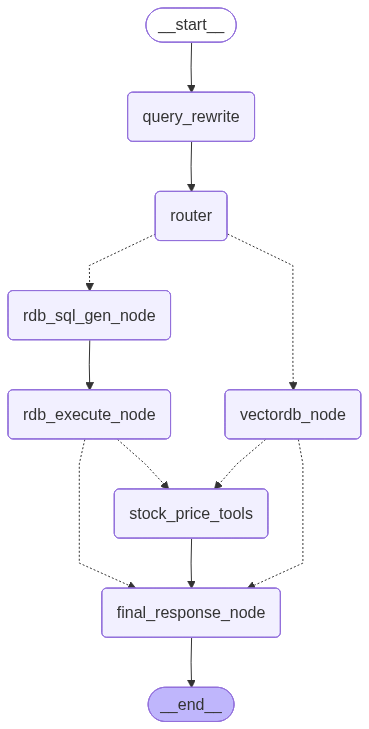

# Architecture

Finance LLM은 증권사 PDF 리포트를 수집, 추출, 색인하고 질문에 맞는 RAG 답변을 생성하는 로컬 애플리케이션입니다.

## 1. 구성 요소

| 영역 | 구현 |
| --- | --- |
| 데이터 수집 | `src/core/report_crawler.py` |
| GUI 백그라운드 업데이트 | `src/core/data_update_jobs.py` |
| PDF 추출 | `src/core/pdf_extraction.py`, `src/core/compare_pdf_extractors.py` (`pymupdf`, `opendataloader`, `docling`, `pdf-to-markdown`) |
| 리포트/검색 메타데이터 | SQLite `DATA_ROOT/retrieval/v2/catalog.sqlite3` |
| 대화 저장 | SQLite `CONVERSATION_DB_PATH` (기본값 `data/conversations.db`) |
| 임베딩 색인 | Immutable `DATA_ROOT/retrieval/v2/snapshots/<snapshot_id>.faiss` + catalog membership |
| 문제 신고 전송 | `ISSUE_REPORT_OUTBOX_DIR/issue-report-outbox.sqlite3`에 대기 이벤트를 기록한 뒤 Supabase 수신함으로 비동기 전송 |
| 생성 모델 | OpenRouter `deepseek/deepseek-v4-flash` |
| 임베딩 모델 | OpenRouter `baai/bge-m3` |
| Rerank | 기본 비활성화, 필요 시 OpenRouter `cohere/rerank-v3.5` |
| 검색/답변 그래프 | LangGraph nodes in `src/nodes/` |
| 답변 참조 링크 | `src/utils/citations.py` |
| UI | Streamlit `apps/gui/app.py` 중심. GUI 답변 생성은 백그라운드 thread로 실행. CLI `apps/cli/app.py`는 deprecated 호환 모드 |

## 2. 데이터 흐름

```text
report_crawler → data/downloaded/*.pdf → embed_pipeline
  → source inventory hash 비교 → 신규·변경 PDF만 추출/chunk/embedding
  → 성공 batch를 작은 불변 검색 단위로 원자적 활성화
  → base snapshot + 활성 batch를 합성해 업데이트 중에도 검색
  → 변경 없는 chunk/vector를 재사용해 마지막에 한 번만 완전한 snapshot 게시
  → native catalog + immutable composite reader → answer + references
```

Streamlit GUI의 사이드바 데이터 업데이트는 `data_update_jobs`를 별도 Python 프로세스로 실행합니다. 이미 완료된 날짜/카테고리 조합을 제외한 날짜 범위만 crawler에 전달합니다. 임베딩 파이프라인은 전체 source inventory를 한 번 스캔한 뒤 신규·변경 PDF만 파싱·임베딩합니다. 성공한 문서는 batch commit 직후 검색 가능하고, 마지막 compaction은 base와 batch vector를 재임베딩하지 않고 재배치합니다. 진행 상태는 `logs/data_update_jobs/status.json`에 기록되며 GUI는 fragment로 이 파일을 주기적으로 읽습니다. 저장 구조와 장애 복구 계약은 [`CONTINUOUS_UPDATES.md`](../operations/CONTINUOUS_UPDATES.md)에 정리합니다.

## 3. 수집 계층

`src/core/report_crawler.py`는 리포트 카테고리와 날짜 범위를 기준으로 PDF를 다운로드합니다.

네이버 증권의 새 리서치 화면(`stock.naver.com/research`)에 맞춰 `/api/stockSecurity/researches/v2/{category}`에서 목록을, `/{category}/{nid}`에서 상세 정보의 `attachUrl`을 조회합니다. 지원 카테고리는 `company`, `industry`, `economy`이며, 날짜 필터와 `index`/`hasNext` 기반 페이지 이동을 사용합니다. 이전 `finance.naver.com` HTML 표 파서는 사용하지 않습니다. 이 API는 사이트 내부 경로이므로 응답 구조 변경 시 수집 코드를 점검해야 합니다.

파일명은 기존 `{유형}_{날짜}_{대상}_{증권사}_{제목}.pdf` 규칙을 유지합니다. HTTP 성공 여부와 실제 PDF 내용을 검증한 후 임시 파일을 최종 경로로 교체하고, 유효한 기존 PDF는 재다운로드하지 않습니다. 일부 증권사 첨부 주소는 PDF가 아닌 웹페이지를 반환합니다. 이런 항목이나 상세 조회 실패는 성공 건수에 넣지 않고 로그에 원인을 남깁니다. 항목별 실패는 나머지 다운로드와 정상 파일의 임베딩을 막지 않으며, 업데이트 상태에 다운로드 실패 건수와 부분 실패를 표시합니다. 목록 조회 자체의 실패나 잘못된 목록 응답은 전체 작업 오류로 처리하고, 정상적인 빈 목록과 개별 다운로드 실패를 구분합니다.

주요 설정은 `src/configs/settings.py`의 `CONFIG_SPECS`에서 단일 관리합니다. 대표적으로 `CRAWLER_CATEGORIES`, `CRAWLER_MODE`, `CRAWLER_TARGET_DATE`, `CRAWLER_TARGET_COUNT`, `CRAWLER_LOOKBACK_DAYS`, `CRAWLER_MAX_LOOKBACK_DAYS`가 있으며 `.env.example`은 이 정의에서 자동 생성됩니다.

특정 날짜에 데이터가 부족해도 이전 날짜를 이어서 탐색해 목표 개수 또는 최대 lookback 범위까지 수집합니다.

## 4. 추출 및 색인 계층

추출과 chunking은 다음 순서로 처리합니다.

1. `extract_pdf_text()`로 PDF 텍스트 또는 Markdown을 추출합니다.
   - 지원 엔진은 `pymupdf`, `opendataloader`, `docling`, `pdf-to-markdown`입니다.
   - 모든 엔진 출력은 색인 전에 표 제거 계약을 통과합니다. PyMuPDF는 기본 `find_tables()`로 찾은 표 BBox와 면적의 50%를 초과해 겹치는 텍스트 block만 제외하고, OpenDataLoader JSON table node와 Docling table structure는 비활성/제거합니다. 별도 off 옵션이 없는 CLI 출력도 공통 Markdown/HTML/plain-text table 제거 후처리를 거칩니다.
   - 배포 템플릿의 production embedding은 기본 `pymupdf`가 실패하면 명시된 `PDF_EXTRACTION_FALLBACK_ENGINE=opendataloader`를 한 번 시도합니다. 새 키가 없는 기존 설정, 빈 값, 또는 primary와 다른 pending extractor override는 자동 fallback하지 않습니다. Native V2 incremental build는 active embedding profile과 동일한 추출 정책만 재사용합니다.
2. `MarkdownHeaderTextSplitter`와 `RecursiveCharacterTextSplitter`로 문서를 chunk로 나눕니다.
3. 신규·변경 문서만 처리해 작은 immutable FAISS segment를 catalog transaction과 함께 활성화합니다. reader와 SQL projection은 base snapshot과 현재 segment head를 같은 revision으로 읽습니다. 이전 버전은 새 버전이 성공할 때까지 유지되며 삭제는 provider 호출 없이 즉시 overlay에서 제외됩니다. 작업 종료 시 기존 parent/chunk/vector를 재사용해 완전한 candidate catalog와 새 immutable FAISS snapshot을 한 번 검증·게시합니다. 검색에서 제외된 segment artifact는 열린 lazy request를 보호하기 위해 소유 base의 GC까지 보존한 뒤 공용 snapshot garbage collector가 게시 후와 정상 시작 시 재조정하며, 운영 상태에는 사용자 용어로 정리 대기 파일 수·용량·최장 보존 시간을 표시합니다.

Profile 변경은 incremental writer가 거부합니다. `tools\recovery\REBUILD_V2.bat --check`로 상태를 확인한 뒤 검증된 full native successor를 준비·게시해야 합니다.

## 5. 검색 계층



이 다이어그램은 compiled main graph를 `xray=True`로 펼쳐 회사 비교 subgraph까지 포함한 현재 실행 구조입니다. 점선은 조건부 전이입니다.

LangGraph는 대략 다음 노드로 구성됩니다.

1. Query rewrite: 사용자 질문을 검색과 SQL 생성에 적합하게 정리합니다.
   - `should_rewrite_with_history()`는 날짜만 바뀐 후속 질문, 직전 답변 범위를 가리키는 질문, 독립적인 새 검색 질문을 구분합니다.
   - `query_rewrite_node()`는 `rewritten_query`와 함께 `uses_chat_history`, `followup_scope_intent`를 state에 기록합니다.
2. Search scope: `src/nodes/search_scope.py`가 metadata filter, 직전 답변 scope 재사용, scope-selection 요청을 결정합니다.
   - GUI가 전달한 `prior_search_scope`와 `followup_scope_intent`를 함께 봅니다. 후속 질문이고 현재 질문에 새 날짜 조건이 없으면 직전 답변의 `search_filters`, `temporal_context`, 참고 PDF `file_names`를 검색 조건으로 재사용합니다.
   - 현재 질문에 새 날짜 조건이 있으면 직전 검색 범위보다 현재 질문의 날짜/필터를 우선합니다.
   - `src/core/followup_scope.py`는 직전 답변의 `answer_scope_index`를 사용해 "개별 종목/주요 기업", "섹터", "거시경제" 같은 섹션 deep-dive 질문을 `company`, `industry`, `economy` report type scope로 해석합니다.
   - 섹션 follow-up이 매칭되면 직전 날짜 범위는 유지하고 stale `file_names` scope는 제거합니다. 적용 근거는 `scope_decision`에 `matched_alias`, `inherited_filters`, `added_filters`, `dropped_filters`로 기록합니다.
   - "top target company"처럼 rewrite된 표현이 있더라도 섹션 follow-up이면 단일 top-company 선택으로 축소하지 않습니다.
3. Router: RDB 검색이 적합한지 VectorDB 검색이 적합한지 선택합니다.
4. RDB path: SQL guardrail을 통과한 read-only SELECT만 SQLite에 실행합니다.
5. VectorDB path: FAISS 후보를 넉넉히 가져온 뒤 metadata filter, 최신성 가중치, 선택형 rerank를 적용합니다.
   - VectorDB 진입점은 `DATA_ROOT`에서 canonical Native V2 catalog와 active snapshot을 확인합니다.
   - 요청은 catalog에서 scope를 compile하고 한 composite revision의 base/segment lease를 함께 잡은 뒤 DIRECT/SELECTOR/ADAPTIVE 전략으로 검색·hydrate합니다. 요청 중 새 batch나 최종 snapshot이 게시되어도 열린 요청은 고정된 revision을 끝까지 사용합니다. Native authority가 손상되면 fail closed합니다.
   - `metadata_matches()`는 날짜/종목/증권사/리포트 유형뿐 아니라 `file_names` 필터도 처리해 직전 답변에 실제 사용된 PDF 범위로 재검색할 수 있습니다.
   - `select_top_passages()`는 명시 파일 scope, 복수 문서/list 의도, 섹션 follow-up에서 `ensure_document_coverage()`를 적용해 최종 context가 한 PDF의 여러 chunk로만 채워지는 상황을 줄입니다. 적용 여부와 이유는 `document_coverage_applied`, `document_coverage_reason`으로 monitoring metadata에 남습니다.
6. VectorDB 결과가 없으면 해당 thread의 short-term memory 영향을 제거하고 원질문으로 한 번 더 검색합니다.
7. Final response: 검색 결과와 참고 문서를 바탕으로 답변을 생성합니다.
   - GUI는 성공한 assistant 메시지 metadata에 `selected_sources`와 `search_scope`를 저장합니다. `search_scope`는 다음 후속 질문의 `prior_search_scope` 입력으로 전달됩니다.
   - GUI 실행기는 compiled graph의 `get_graph(xray=True)` topology와 `tasks` stream을 함께 수집합니다. 완료 또는 제한시간 중단 후 `graph_schema_version`, `graph_manifest`, `node_runs`를 assistant monitoring metadata에 저장하며 node input/result 값은 저장하지 않습니다. NodeRun은 invocation 회차와 trace 기준 상대 시각을 포함하므로 병렬 실행의 wall-clock 구간과 개별 작업시간 합계를 구분할 수 있습니다.
   - `selected_sources`에는 답변에 사용된 source의 `report_type`도 포함되어 이후 `answer_scope_index` 구성과 monitoring의 섹션별 source 확인에 사용됩니다. `rerank_info`는 기존 대화 호환용 read fallback입니다.
   - GUI source renderer는 같은 PDF에서 검색된 여러 chunk를 `group_sources_by_document()`로 문서 단위로 묶고, `document_rank_aliases()`로 원래 chunk rank를 1부터 시작하는 문서 표시 번호로 다시 매깁니다.

## 6. 메타데이터 필터와 최신성 가중치

`src/core/metadata_filters.py`는 질문에서 다음 정보를 추론합니다.

- 종목명 또는 대상명
- 증권사명
- 리포트 유형
- 날짜, 월, 분기, 연도 표현

`src/nodes/vectordb.py`는 필터링 전 후보를 충분히 가져온 뒤 조건에 맞는 문서를 고릅니다. `RECENCY_WEIGHT`가 0보다 크면 최신 `report_date` 문서에 점수 가중치를 부여합니다.

후속 질문에서 직전 답변의 문서 범위를 재사용할 때는 `file_names` 필터가 함께 들어갈 수 있습니다. 이 필터는 종목/날짜 조건만으로는 같은 범위가 보장되지 않는 경우를 막기 위해, 직전 답변에 실제 사용된 PDF 파일명과 일치하는 chunk만 남깁니다. 반대로 답변의 한 섹션을 더 자세히 묻는 경우에는 섹션 `report_type`을 새 범위로 사용하므로 기존 `file_names`를 제거합니다. 이렇게 해야 "개별 종목/주요 기업" 후속 질문이 직전 전체 답변의 일부 파일 목록이나 단일 top company로 과도하게 좁혀지지 않습니다.

## 7. Rerank

Rerank는 비용을 고려해 기본값이 꺼져 있습니다.

```env
USE_RERANKER=false
```

켜면 OpenRouter의 `cohere/rerank-v3.5`를 사용합니다.

```env
USE_RERANKER=true
RERANK_PROVIDER=openrouter
RERANK_MODEL=cohere/rerank-v3.5
```

검색 후보 수는 `SEARCH_TOP_K × SEARCH_CANDIDATE_MULTIPLIER`로 계산합니다. `SEARCH_CANDIDATE_MULTIPLIER`의 기본값은 `1`이며, 모니터링에서 문서 검색 누락이 확인될 때만 높입니다.

## 8. 대화 장기 메모리

`src/core/conversation_store.py`는 SQLite `CONVERSATION_DB_PATH`에 thread와 message를 저장합니다. 설정을 비워두면 `data/conversations.db`를 사용합니다.

- GUI는 저장된 thread와 메시지를 불러와 화면에 표시합니다.
- GUI 답변 생성은 백그라운드 thread에서 실행되고, assistant 메시지는 먼저 `status=running`으로 저장된 뒤 완료 시 `status=succeeded`, 실패 시 `status=failed` metadata로 갱신됩니다.
- deprecated CLI는 기존 호환성을 위해 기본 thread를 계속 사용하지만 신규 기능 개발 대상이 아닙니다.
- assistant 메시지는 참고 문서와 `selected_sources` 정보를 metadata로 함께 저장할 수 있습니다. 기존 `rerank_info`는 read fallback으로만 지원합니다.
- GUI assistant 메시지는 성공 시 `search_scope` metadata를 추가로 저장합니다. 값에는 `route`, `search_filters`, `temporal_context`, `scope_source`, `file_names`, `answer_scope_index`가 포함될 수 있으며, 이후 같은 thread의 후속 질문에서 가장 최근 성공 답변의 scope를 재사용합니다.
- GUI assistant 메시지는 실행 당시 graph topology revision과 노드별 상태·시간도 저장합니다. topology가 바뀐 뒤에도 과거 응답은 현재 graph를 참조하지 않고 자기 manifest를 사용합니다.

## 9. 문제 신고

GUI의 `신고` 버튼은 `src/core/issue_report_store.py`에서 메모리 payload를 구성하고 `src/core/issue_report_outbox.py`를 통해 `ISSUE_REPORT_OUTBOX_DIR/issue-report-outbox.sqlite3`에 기록합니다. `ISSUE_REPORT_OUTBOX_DIR`을 비워두면 `<DATA_ROOT>/issue-report-outbox`를 사용합니다. durable enqueue가 끝나면 사용자에게 접수 완료를 표시하고, HTTP 전송과 제한된 재시도는 백그라운드 worker가 담당합니다. 전송 완료·거절·만료 이벤트는 outbox에서 제거합니다.

- 설명·선택 질문·응답·turn trace는 각각 별도 동의를 받아 포함하고, 전송 전에 민감정보와 로컬 경로를 redaction합니다.
- 현재 GUI는 로컬 `.txt`/`.json` 신고 파일을 만들지 않으며 원격 접수가 비활성화되면 제출도 비활성화합니다.
- 과거 로컬 issue artifact API는 호환·연구용으로 남아 있지만 활성 Monitoring 화면에서는 노출하지 않습니다.

### Chat Monitoring trace viewer

`개별 Chat Monitoring`은 assistant 응답 row에서 확인할 턴을 선택하는 trace viewer를 제공합니다. 개별 Chat 화면의 row는 상태, 실제 검색 실행 방식, 총시간, 요청 대상별 근거, 인용 연결, 질문을 우선 표시합니다. 응답을 선택하면 화면은 좌측 compact 실행 그래프와 우측 상세 패널로 나뉩니다. 전역 Monitoring의 응답 원인 확인 화면은 기존 route, k, state 중심 row를 유지합니다.

개별 Chat에서 선택된 응답은 다음 정보 우선순위로 표시됩니다.

1. Execution graph: 좌측은 응답 metadata의 versioned graph manifest와 NodeRun을 데이터 기반으로 렌더링합니다. 실행 노드와 실행되지 않은 조건부 분기, 일반/조건부 topology edge를 구분하되 edge 통과 여부는 추정하지 않습니다. snapshot이 없는 기존 응답만 6단계 projection을 사용하며 손상되거나 미지원인 schema는 오류로 표시합니다. 기본 선택은 `전체 지표`이며 노드를 누르면 응답별 session state에 선택을 보존합니다.
2. Answer verdict: 우측 전체 지표는 총시간, 검색 실행 방식, 대상별 근거 확보, 인용 연결을 카드로 보여줍니다.
3. Performance evidence: 실제 계측된 backend 또는 비교 branch 시간만 표로 보여줍니다. 병렬 branch의 가장 느린 검색과 작업시간 합은 서로 다른 값으로 유지합니다.
4. Retrieval coverage: 복수 기업 비교라면 대상별 상태·후보 수·검색시간·대기시간과 전역 rerank/합성 횟수를 보여줍니다.
5. Answer evidence: 최종 prompt에 사용된 문서를 대상·발간일·증권사·인용 chunk와 함께 보여줍니다.
6. Node detail: 좌측 단계 노드를 선택하면 우측은 해당 단계의 저장된 상태와 시간, 입력·출력 요약, 검색 근거를 보여줍니다.
7. Technical details: `기본만 / 이전 응답 비교 / 기술 세부정보` selector에서 명시적으로 선택했을 때만 query rewrite, scope/routing, 검색 k, retrieval/answer/grounding 원자료, prompt chunk, state transitions를 렌더링합니다. 대화 전체 속도 추이도 기본 화면에서 접습니다.

비교 실행 metadata에는 compact retrieval plan과 실제 `execution_mode`, 대상별 상태·후보 수·retrieval/queue 시간, 전역 rerank/합성 횟수를 저장합니다. 운영 그래프의 복수 기업 비교는 항상 LangGraph `Send`를 사용하며, 순차 경로는 동등성 검증용 내부 회귀 테스트로만 유지합니다. UI는 저장된 실행 mode와 실측 동시성을 함께 표시하고, 과거 응답은 실행 방식이나 현재 LangGraph의 개별 NodeRun을 추정하지 않습니다. 신규 응답의 좌측 그래프는 실행 당시 topology와 task event의 스냅샷이며 기존 응답에만 6개 compact 단계 fallback을 적용합니다. 또한 날짜 필터 손실, prior scope 미사용, no-result, route/content-intent 불일치, document coverage 미적용 같은 흔한 RAG 실패 패턴은 rule-based debug hint로 노출합니다.

## 10. 참고 문서 네비게이션과 PDF 위치 이동 한계

현재 GUI는 답변 안의 `[숫자]` 참조를 참고 문서 expander의 해당 항목으로
이동하는 내부 anchor 링크로 변환합니다. 참고 문서 expander는 기본적으로 접힌
상태이며, 사용자가 필요할 때 직접 펼칩니다. Streamlit 상단 바에 가려지지 않도록
anchor에는 scroll margin을 둡니다.

검색 결과는 chunk 단위 rank를 갖지만, GUI 참고 문서 목록은 PDF 문서 기준으로
중복을 제거합니다. 같은 PDF에서 여러 chunk가 검색되면 답변 citation은 하나의
문서 번호로 alias되고, 문서 목록 표시 번호는 원래 chunk rank가 아니라
1부터 순차적으로 다시 부여됩니다. 따라서 원래 검색 rank가 `[1], [2], [4], [13]`
처럼 건너뛰어도 화면에는 `[1], [2], [3], [4]`처럼 표시됩니다.

참고 문서의 `열기` 버튼은 로컬 PDF 파일 자체를 엽니다. V2 chunk에는 parent content 내부의 `span_start`/`span_end`가 있지만 원본 PDF의 page number와 bounding box는 없습니다. 따라서 parent text 위치는 복원해도 GUI에서 원본 PDF의 정확한 페이지·좌표로 이동하는 기능은 아직 제공하지 않습니다.

## 11. 데이터 상태와 캘린더

`src/core/status.py`는 canonical runtime을 통해 catalog/FAISS/설정 상태를 읽기 전용으로 요약합니다. 캘린더는 active snapshot의 `active_reports`를 기준으로 검색 가능한 날짜를 표시합니다.

업데이트 대상 계산은 날짜와 report type을 함께 봅니다. 예를 들어 특정 날짜에 `company`는 있지만 `industry`가 없으면 사용자가 `industry`를 선택했을 때 그 날짜를 다시 수집/임베딩 대상으로 포함합니다. 집계에는 latest report objects와 active manifest를 사용합니다.

## 12. 기업 리포트 종합

사이드바에서 `기업 리포트 종합` 화면을 연 뒤 화면 폼에서 회사와 발행일 범위(양끝 포함)를 선택한다. `조회`는 본문 준비 자료와 준비 미완료·제외 자료의 미리보기를 보여준다. `종합 생성`은 같은 조건으로 corpus를 다시 읽고 제출 시점의 문서 버전을 작업 입력으로 고정한다. 결과는 문서별 요약 모음이 아니라, 기간 시작 시점의 인식에서 주요 전개와 동인을 거쳐 종료 시점의 상황까지 연결해 해당 기업에 대해 새로 작성한 서술형 리포트다. `핵심 판단` 바로 다음에 `기간 내 기업 흐름`을 두고, `사업·실적 전개와 전망`·공통 견해·이견·위험과 향후 확인 사항·종합 결론을 이어간다. 같은 증권사의 관점 변화는 `증권사 전망의 변화`로 기업 흐름과 분리하며, 전체 대상 문서와 최종 리포트에 사용한 검증된 원문 인용을 근거 부록으로 제공한다.

- `src/core/report_corpus.py`: Native V2 SQLite의 활성 문서와 전체 parent 본문을 같은 읽기 트랜잭션으로 조회한다. 회사·양끝을 포함한 발행일 범위로 고정하고 `report_date, broker, title, report_uid` 순서를 사용한다. 준비된 delta의 교체·삭제와 추출 프로필을 적용하며 벡터 검색이나 임베딩을 호출하지 않는다. manifest와 로컬 PDF를 대조해 확인된 제외 사유와 준비 상태를 보존한다.
- `src/core/report_synthesis.py`: 준비된 parent 본문을 로컬에서 발행일 순으로 정렬하고 `prepared` 상태와 글자 수·구간 수를 기록한다. 문서별 LLM 추출이나 요약은 호출하지 않는다. 문서 200건·본문 200만 자·분할 구간 500개 초과 시 실행 전에 범위를 줄이도록 안내한다.
- corpus 조회는 같은 활성 문서·추출 프로필의 SQL 집계로 실행 한도를 먼저 검사한다. 초과하면 parent 본문을 Python으로 읽거나 PDF 목록을 대조하기 전에 중단하고 기간 축소를 안내한다. 생성 서비스도 전달받은 고정 입력에 대해 한도를 다시 검사한다.
- 시스템 지시·직렬화한 본문 payload·호출별 응답 스키마가 보수적인 UTF-8 60,000바이트 예산 안이면 전체 본문을 한 번의 최종 작성 요청에 전달한다. 이는 정확한 토큰 수가 아니다. 예산을 넘으면 여러 문서를 발행일 순서의 묶음으로 나눠 최대 3개까지 병렬 종합하고, 검증된 묶음 결과는 더 큰 120,000바이트 예산으로 최종 작성에 전달한다. 원문 요청을 작게 나눠 오래 걸리는 단일 생성을 줄이고, 중간 근거가 불필요하게 여러 번 재종합되는 것도 방지한다. 원래 문서 순서로 출처 번호를 고정하며 일부 문서를 top-k로 버리지 않는다.
- 최종 응답이 반환한 인용은 `report_uid`와 parent 위치를 사용해 실제 원문에 존재하는지 로컬에서 검사한다. 공백·줄바꿈만 다른 인용은 실제 원문 문자열과 위치로 복원하고 숫자·문자·문장부호 변경은 거부한다. GUI의 근거 부록은 이 검사를 통과하고 해당 문서 ID와 일치하는 인용만 보여주며 원문 본문이나 내부 JSON은 표시하지 않는다.
- 모델 호출·JSON 형식·출력 계약·원문 인용 검증 오류는 자동 재시도 없이 실패로 기록하며 SDK 재시도도 끈다. GUI는 본문 읽기 실패와 종합 작성 실패를 구분해 표시하고 사용자가 재시도 버튼을 눌렀을 때만 같은 고정 자료로 새 작업을 시작한다. 성공 응답의 토큰 수와 호출 시간은 본문·응답 원문 없이 기존 애플리케이션 로그에 기록한다.
- `src/core/report_synthesis_store.py`, `apps/gui/synthesis_jobs.py`: `<DATA_ROOT>/report_synthesis.sqlite3`에 고정 자료·작업 상태·결과·검증된 종합 묶음 캐시를 저장한다. 세션당 진행 작업은 하나이며 실패·부분 완료는 같은 자료로 수동 재시도한다. 성공 묶음의 캐시 키에는 고정 입력·실제 모델·프롬프트·출력 스키마 버전을 포함하고, 실패한 종합 단계만 다시 처리한다. 실행 중 작업과 프로세스 식별자는 기존 Chat처럼 `st.cache_resource`에 보존한다.
- 결과·실패 상태 저장이 모두 실패해 작업 행만 실행 중으로 남은 경우, 다음 저장소 접근에서 동일 프로세스의 살아 있는 스레드 목록과 대조해 실패로 복구한다. 생성·스레드 등록·복구는 같은 잠금 아래에서 수행하며, 실제 실행 중인 작업과 다른 프로세스의 작업은 이 복구 대상으로 삼지 않는다. 복구 helper는 갱신되는 GUI 작업 모듈에 두어 이전 저장소 객체에 새 메서드를 요구하지 않는다.
- 중간·최종 종합은 발행일 순서를 보존하고, 최종 `기간 내 기업 흐름`은 날짜가 있는 원문 근거만 연결한다. 실제 인용된 문서에 두 날짜 이상의 근거가 있으면 그 범위의 가장 이른 발행일과 가장 늦은 발행일을 포함한다. 한 날짜만 있으면 기간 변화를 판단할 수 없다는 한계를 출력한다. 발행일을 사건 발생일로 바꾸어 해석하지 않으며, 증권사 구성 차이를 실제 기업 변화나 한 증권사의 전망 변화로 간주하지 않는다.
- 원문 전체를 순서대로 이어지는 인용 구간으로 전달하고 작성 모델은 `source_id`·`quote_id`만 선택한다. 코드가 원문 문자열·parent 위치를 복원하며 잘못된 구간 ID와 출처 불일치는 실패로 처리한다. 중간 종합에도 검증된 인용만 새 구간 ID로 전달하며 문자열 인용 응답의 엄격한 검증도 유지한다. GUI는 저장된 실패 원인을 안전한 범주별 안내로 표시한다.
- 최종 종합과 중간 축약은 공통 모델 프로필로 `reasoning.effort=none`·출력 상한 12,000토큰을 사용한다. reasoning 실험은 처리 지연과 사용자 요청에 따라 비활성화하고 별도 단계 분기·큰 출력 예산·timeout을 제거했다. DeepSeek V4의 strict JSON Schema와 `require_parameters`, 데이터 수집 제한, 자동 재시도 0을 유지한다. 실제 reasoning·출력 상한을 캐시 키에 포함한다. 응답 종료 상태를 확인한 뒤 JSON과 원문 인용을 검증하며 비공개 추론을 본문이나 불완전한 JSON의 대체값으로 사용하지 않는다. 빈 본문·출력 한도 종료·서버 중단을 구분하고 응답 원문 없이 진단을 기록한다.
- 최종 입력의 `requirements.period_flow_plan`은 관측된 고유 발행일을 최대 세 연속 구간으로 묶고 id·구간명·발행일 범위·해당 출처 ID를 제공한다. 같은 날의 문서 수는 구간을 편향시키지 않는다. 한 날짜는 `snapshot`, 두 날짜는 `opening/closing`, 세 구간은 `opening/middle/closing`이다. 신규 strict 응답의 `period_flow`는 해당 키를 모두 요구하는 객체이며 구간별 `phase_quote_id`를 해당 출처의 실제 인용과 대조한다. 코드가 검증한 구간명·발행일 머리말을 붙이고 모델은 분석만 작성한다. 구간 누락·추가·중복, 다른 구간의 인용은 거부한다. 이전 배열과 정규화된 `statements`는 일반 모드에서 호환을 유지한다.
- 최종 작성 스키마는 `summary`·`conclusion`을 필수 문단 배열, `period_flow`를 시기별 문단 객체, `additional_statements`를 추가 분석 배열로 요구한다. 최대 세 시기·필수 배열별 최대 3문단·추가 분석 전체 최대 6문단·분석 문단별 최대 800자로 제한한다. 시기별 일반 인용은 최대 13개로 제한해 구간 직접 근거와 최대 두 경계 근거를 포함해 16개 안에 들어오도록 한다. 최초 인용은 첫 구간에, 최종 인용은 마지막 구간에만 복원한다. 중간 인용 ID 중복·출처 불일치를 거부하고 저장 결과는 기존 `statements` 형식으로 정규화한다. 구조와 원문 위치 검증은 각 문장의 의미적 사실 정확성을 보장하지 않는다.
- 인용 누락만으로 중간·최종 종합을 중단하지 않고 실제 검증된 근거로 부분 결과를 제공한다. 본문 준비 건수(`counts.completed`)와 실제 인용 범위(`coverage.prepared/cited/uncited`)를 구분하며, 누락 문서의 사유는 전체 대상 목록에 보존한다. 인용 출처·후속 질문에는 최종 인용 문서만 포함하고 기간 흐름의 최초·최종 발행일도 그 범위에서 검증한다. 각 인용의 원문 일치와 필수 문단 검증은 유지한다. 누락이 있는 묶음은 캐시에 넣지 않아 사용자의 수동 재생성에서 다시 작성한다.
- 분석 문단은 속성 없이 정상 중첩된 `b/strong/i/em/u/span/p/div/br/sub/sup` 서식만 일반 텍스트로 변환한다. 문단·줄바꿈은 경계를 보존하고 위첨자·아래첨자는 `^(...)`·`_(...)`로 표시한다. 원문 인용과 위치는 변환하지 않는다. 속성·비허용 태그·주석·선언·잘못된 중첩은 거부하며 변환 후 빈 문단·길이·Markdown 링크·자동 링크·인용 번호·잔여 HTML을 검사한다. 금융 비교식과 한국어 꺾쇠 문구, 연도·종목코드는 그대로 보존한다. 최종 작성 프롬프트만 일반 텍스트를 명시해 이미 검증된 중간 종합의 캐시 키를 유지한다. 검증 실패에는 본문 없는 사유 코드를 기록한다.
- 길이가 긴 논리 문단은 전체 분량 상한 안에서 원래 텍스트·주장 ID·인용 근거를 그대로 저장한다. 최종 본문 총 33,600자·논리 문단 24개·섹션별 6개와 중간 종합의 기존 작성 예산을 검증한다. `_render`에서만 문장·줄바꿈 경계를 우선해 1,400자 이하로 표시 문단을 나누고 각 문단에 원래 인용 번호를 붙인다. 내용을 잘라내거나 표시 문단을 새 주장으로 취급하지 않는다.
- 선택 비교 문단의 원문 인용은 먼저 엄격히 검증한다. 이후 공통 견해·이견의 독립 증권사 근거나 전망 변화의 동일 증권사·서로 다른 발행일 근거가 부족하면 해당 문단을 제외하고 핵심 분석을 부분 결과로 유지한다. 제외된 문단은 다른 섹션으로 재분류하지 않으며 안전한 단계·섹션·사유를 `validation_warnings`에 기록한다. 병렬 중간 종합은 각 묶음의 사유를 순서대로 합치며 제외가 있는 묶음은 캐시에 넣지 않는다. GUI 결과·작업 완료·재생성 버튼이 문단 제외와 문서 준비 실패를 구분한다. 필수 문단·기간 흐름·모든 실제 원문 인용의 검증은 유지한다.
- 새 결과는 `processing_mode=raw_body`, 최종 작성 버전 `rdb-report-14`로 저장한다. GUI는 이전 결과의 문서별 분석 표시와 이전 작성 방식 경고를 읽기 호환으로 유지하되 새 작업에는 문서 추출 캐시를 사용하지 않는다.
- `apps/gui/synthesis_views.py`: 실행 중 작업은 2초 간격 fragment polling으로 처리 건수를 갱신한다. polling 중 `completed`·`partial`·`failed`·`empty` 전환을 처음 감지하면 app rerun을 한 번 실행해 fragment polling을 중단하고 결과와 사이드바 기록을 같은 화면 상태로 갱신한다. 기존 session state의 회사·기간 위젯 값과 별도로 저장한 확정 조건은 이 갱신에서 초기화하지 않는다. 완료·부분 완료·실패·빈 결과는 공통 표시 경로를 사용하고 `결과 확인` 버튼은 제공하지 않는다. 종료 시 갱신 자체는 모델 호출이나 자동 재시도를 시작하지 않으며 추가 모델 호출은 사용자가 재생성·재시도 버튼을 누른 경우에만 수행한다. 같은 URL의 세션 식별자로 최근 작업을 복구하고 PDF는 경로와 원문 해시를 검증한다.
- `synthesis_session` query parameter는 canonical UUID만 허용하는 로컬 작업 소유자 키다. 작업 조회는 이 값과 `owner_id`가 일치하는 행으로 제한되고 사이드바는 해당 소유자의 최신 100개 작업을 상태와 함께 다시 연다. 이는 계정 식별자가 아니며 같은 URL만으로 다른 서버나 다른 `DATA_ROOT`의 기록을 복구하지 않는다. URL을 전달받은 브라우저는 같은 로컬 앱에서 해당 키를 다시 사용할 수 있다.
- 종합 기록 조회에서 `OSError` 또는 SQLite 오류가 나면 해당 기록 영역만 짧은 사용 불가 안내로 대체한다. 일반 Chat 사이드바는 계속 동작하며 provider 예외 문자열이나 저장 payload를 노출하지 않는다.
- 사이드바에서 과거 결과를 열어도 생성 버튼은 별도로 해당 소유자의 최신 작업을 확인한다. 실행 중 작업이 있으면 다른 결과가 표시 중이어도 두 번째 작업을 시작하지 않는다.
- 확정한 회사·발행기간은 위젯과 분리해 세션에 저장한다. 화면 이동으로 Streamlit 위젯 상태가 정리돼도 입력 조건을 복원하며 새 세션은 소유권이 확인된 최근 작업의 조건을 사용한다. 빈 조회의 `available_period`는 동일 읽기 트랜잭션의 활성 기업 자료 전체 발행일 범위이며, 안내에만 사용하고 기간 밖 본문을 가져오거나 scope fingerprint에 포함하지 않는다. Monitoring 모드가 켜져 있으면 종합 화면에서도 선택 라디오를 유지하고 선택 콜백으로 해당 라우트로 이동한다. 기존 운영자 접근 조건은 유지한다.
- 결과·원문 근거의 숫자 범위는 기존 `escape_numeric_tildes_for_markdown`으로 표시할 때만 보호하며 양수·음수 범위와 유니코드 마이너스도 지원한다. 저장된 본문과 인용 문자열은 바꾸지 않는다. 새 작성기의 정확한 제목·범위·건수 머리말만 중복 표시에서 제외하고 기존 형식은 보존한다. 결과 본문은 범위가 제한된 정적 CSS로 88ch·1.8 행간을 적용하며 640px 이하에서 지표를 두 열로 배치한다. 생성된 본문에는 기본 안전 Markdown 렌더링을 사용하고, 부분 결과 원인 안내는 한 번 표시한다.
- raw-body 결과는 hot reload 대상인 `src/core/chat_ui_helpers.py`의 `display_report_content()`를 통해 표시한다. 이 helper는 이전 renderer가 본문에 저장한 정확한 중복 안내 문단만 화면에서 제외하며 저장된 본문, `diagnostic`, `validation_warnings`는 수정하지 않는다.
- 근거는 기본으로 접힌 단일 부록 아래에 모은다. 검증된 인용 문서는 문서 번호와 발행일·증권사·제목을 한 번 표시하고, 문서 내부에는 준비 상태·원문 인용·검증된 로컬 PDF 다운로드를 둔다. 인용 anchor와 PDF 동작은 현재 실행 중인 앱과 서버 자료에 의존하므로 외부로 복사 가능한 영구 링크가 아니다.
- 후속 질문은 완료한 문서의 회사·기간·파일명·문서 버전을 metadata로 넣은 별도 대화를 생성한다. 다음 rerun에서 Monitoring 선택 상태를 Chat으로 먼저 되돌린 뒤 새 대화를 표시한다. RDB 검색 출처의 `source_uid`와 종합 범위의 `report_uid`를 동일한 Native V2 문서 버전 식별자로 비교한다. 필드 이름만 다른 동일 버전은 허용하고 실제 문서 버전이 달라지면 답변을 게시하지 않은 채 새 종합을 안내한다. 사용자가 명시적으로 회사·기간을 변경한 질문은 새 범위로 처리한다.

종합 입력은 **검색용으로 준비된 본문**이다. 기존 PDF 추출 단계에서 제거된 표는 복원하지 않으며 정밀 수치 비교나 원문 PDF의 페이지 좌표 이동을 제공하지 않는다. 실제 모델의 의미적 정확성·비용·시간과 모바일·접근성 사용성은 별도 검증 대상이다. 설계 계약은 [DESIGN.md](../../DESIGN.md), 실제 Streamlit 위젯 흐름 검증은 `tests/test_synthesis_app_flow.py`를 참조한다.

## 13. 검증

주요 검증 명령은 다음과 같습니다.

```bash
python -m compileall -q apps src scripts
python -m pytest -q
```

활성 Native V2의 profile을 변경하는 전체 successor 절차는 [Native V2 전체 재구축](../reference/migrations/v2/V2_REBUILD.md)을 참고합니다.
